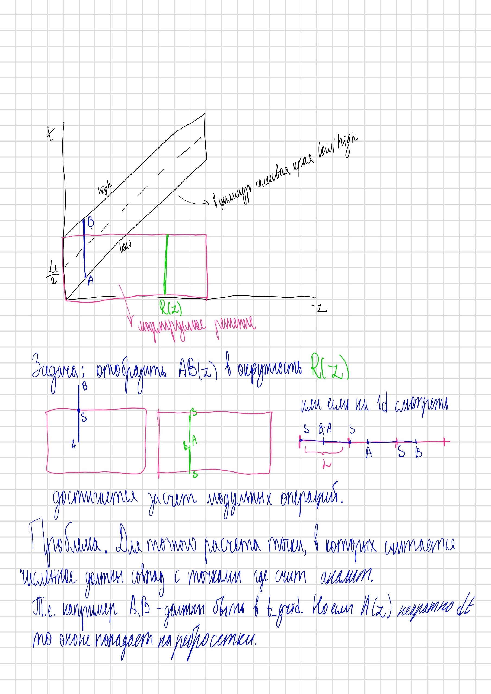

# Расщепление импульсов в парных уравнениях Гинзбурга-Ландау

Аналитическое решение. Проблема возникает при попытке получить из точного решения периодичность.
Условно говоря мы считаем численно полосу на плоскости.



```python
def bright_soliton_analytical(
    self,
    t_grid: np.ndarray,
    z: npt.NDArray[np.float64] | float,
    params: dict,
    moving_frame=True,
    middle=True,
    mod_error: List|None=None
):
    # just params for analytical solution
    k = params["k"]
    c0 = params["c0"]
    omega = params["omega"]
    w0 = params.get("w0", 0.0)

    L_t = t_grid[-1] - t_grid[0]
    t0 = t_grid[0]

    xi1 = (self.beta2 * omega**2 - 2 * omega / c0 + 2 * k - self.delta_beta) / (
        self.beta2 * c0**2
    )
    xi2 = -2 * self.gamma / (self.beta2 * c0**2)

    if xi1 >= 0:
        raise ValueError(f"$xi1$ is wrong: {xi1}")
    if xi2 <= 0:
        raise ValueError(f"xi2 is wrong: {xi2}")

    eta = np.sqrt(-xi1)
    A = np.sqrt(-2.0 * xi1 / xi2)

    t = t_grid
    if isinstance(z, np.ndarray):
        # z at axis 1
        z, t = np.meshgrid(z, t)

    # move t frame to z
    if moving_frame:

        # to have proper segment we should set low = t0
        if middle:
            low = (z - w0) / c0 + (-L_t / 2)
        else:
            low = (z - w0) / c0 + t0


        temp = t + low
        # try with roll
        t = low + np.mod(t - low, L_t)


        if mod_error is not None:

            print(temp[:, 20])
            print(t[:, 20])

            if len(t.shape) == 1:
                t = t.reshape(-1, 1)
                temp = temp.reshape(-1, 1)

            max_t_grid_shift_by_z = np.max(
                np.abs(np.sort(t.T % L_t, axis=1) - np.sort(temp.T % L_t, axis=1))
            )
            mod_error.append(max_t_grid_shift_by_z)

    w = z - c0 * t - w0
    arg = eta * w
    envelope = A / np.cosh(arg)

    phase = np.exp(1j * (k * z - omega * t))
    u_exact = envelope * phase
    # print(np.all(u_exact == old))
    v_exact = np.zeros_like(envelope)

    return u_exact, v_exact
```

`t_grid` массив с точками сетки по времени начиная слева. Отображаем отрезок с солитоном в центре в окружность.
(Другие отрезки хуже себя ведут. Но вообще `(z - w0) / c0 + x`, `x` можно выбирать по-разному. )

```python
L_t = t_grid[-1] - t_grid[0]
t0 = t_grid[0]
low = (z - w0) / c0 + (-L_t / 2)

temp = t + low
# try with roll
t = low + np.mod(t - low, L_t)

w = z - c0 * t - w0
arg = eta * w
envelope = A / np.cosh(arg)

phase = np.exp(1j * (k * z - omega * t))
u_exact = envelope * phase
v_exact = np.zeros_like(envelope)

return u_exact, v_exact
```

Отслеживание максимальной разности $\approx O(dt)$

```python
if len(t.shape) == 1:
    t = t.reshape(-1, 1)
    temp = temp.reshape(-1, 1)

max_t_grid_shift_by_z = np.max(
    np.abs(np.sort(t.T % L_t, axis=1) - np.sort(temp.T % L_t, axis=1))
)
mod_error.append(max_t_grid_shift_by_z)
```
